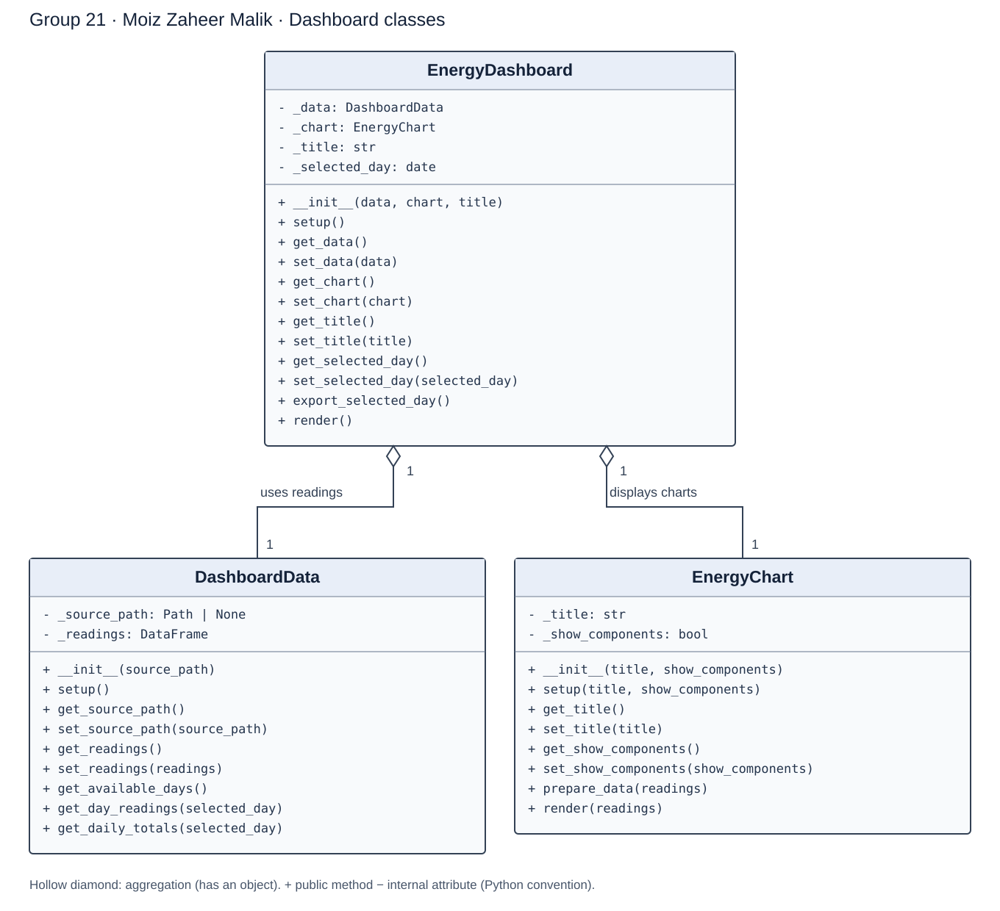

# AI-Powered Smart Energy Management System
## Group 21
## Video link for Database Access and Web Application Using Flask:
(https://drive.google.com/file/d/1JpGdThGkxlC3Hdem0WNNzoET9P1eTuc7/view?usp=drive_link)

A Python project that simulates household electricity use,
solar generation, battery storage and smart appliances.

The system aims to reduce electricity costs and carbon
emissions while maintaining household comfort.

## Final integration demo

Use the **final-integration** branch for the combined demo. Choose a date to
view household electricity use, solar generation, electricity prices, and the
individual household loads. The dashboard also shows estimated daily cost and
carbon emissions, a battery recommendation for the highest-price interval, and
a sustainability summary. You can download the selected day's readings as CSV.

Pravallika's importer prepares and stores the readings in SQLite. Moiz's Flask
API retrieves them and passes the selected day's data to Elizabeth's logic
engine and Kennedy's advisor and summarizer. Moiz's Streamlit dashboard shows
their results together.

### 1. Install dependencies and prepare the database

Open PowerShell in the repository root on the final-integration branch. If the
project already has a .venv folder, skip the first command.

```powershell
py -m venv .venv
.\.venv\Scripts\python.exe -m pip install -r requirements.txt
Set-Location .\data
..\.venv\Scripts\python.exe -m src.main --file Full_HA_dataset.csv
Set-Location ..
```

The importer creates the local SQLite database from the included dataset. Each
teammate runs this step on their own machine.

### 2. Start the Flask API

Run this in the first terminal from the repository root and leave it running.

```powershell
.\.venv\Scripts\python.exe api_server.py
```

### 3. Start the Streamlit dashboard

Open a second terminal in the repository root.

```powershell
.\.venv\Scripts\python.exe -m streamlit run app.py
```

Open the local address printed by Streamlit. Choose **1 January 2020** to see
55.31 kWh of household consumption, 9.24 kWh of solar generation, and
48 half-hour readings. The demo shows an estimated cost of $1.32 and estimated
emissions of 17.79 kg CO₂. The sustainability summary works offline.

### Verify the demo

With Flask running, open a free PowerShell terminal and request the daily
results directly.

```powershell
Invoke-RestMethod http://127.0.0.1:5000/api/metrics/2020-01-01 | Format-List
```

We checked that changing the date updates the dashboard. The 20 API connection
and electricity price chart tests also passed on this branch. To run them from
the repository root:

```powershell
.\.venv\Scripts\python.exe -m unittest discover -s tests -v
```

The demo reports estimates based on historical readings. Battery charge levels
over time and savings against a baseline are planned features.

## Team Members

| Member | Responsibility |
|---|---|
| Varikuti Pravallika | Assets and Database |
| Elizabeth Chikhladze | Deterministic Logic Engine: energy, cost and carbon calculations |
| Joachim Kennedy Gomes | AI Engine and Summary |
| Moiz Zaheer Malik | Web UI / Dashboard |


## Planned Features

- Load energy, solar, price and occupancy data.
- Model batteries and smart appliances using Python classes.
- Recommend battery charging, discharging and appliance schedules.
- Calculate costs, savings, carbon emissions and sustainability scores.
- Display results, recommendations and alerts on a dashboard.

## Dataset

Residential HEMS dataset by Mozhgan Rahmatinia, Version 1.
Data contains readings at 30-minute intervals.

Source: https://data.mendeley.com/datasets/23s96gn2j7/1
License: CC BY 4.0

## Assets and Database

The assets subsystem models household energy equipment:

- `EnergyAsset` provides shared identity, configuration, and state interfaces.
- `Battery` tracks capacity, efficiency, charging, discharging, and state of charge.
- `SolarPanel` estimates generation from panel area, efficiency, and irradiance.
- `SmartAppliance` tracks on/off status and energy consumption.
- `Building` manages assets and simulates supply, demand, battery use, and grid import/export.

The SQLite database stores asset specifications and state, energy readings,
simulation results, and alerts. The importer supports CSV and Parquet files,
including the project's wide-format household dataset; it reshapes and validates
the data before storing readings and reporting data quality. Column mappings,
validation limits, and the database path are configured in
`data/src/config.json`.

Implementation: `data/src/assets/` and `data/src/data_base/`.

## System Design

The rendered diagram below shows Moiz's implemented dashboard classes.
Each class has a constructor, setup logic, and getter/setter methods.



## Team Presentation

**Presentation link: pending the team's recording.**

For Homework 1, record one combined team video lasting 3 to 5 minutes. Each
member explains their own implemented classes. 


## Homework 1 Project Status

For Homework 1, the dashboard read the included CSV. The assets and SQLite
database subsystem ran separately. See the [final integration demo](#final-integration-demo)
for the current setup.

## Varikuti Pravallika's Homework 1 Contribution

| Class | Responsibility | Example behavior |
|---|---|---|
| `EnergyAsset` | Define the common identity, configuration, and state interface for assets | `configure()` / `state()` |
| `Battery` | Track battery capacity, efficiency, and stored energy | `charge()` / `discharge()` |
| `SolarPanel` | Estimate energy generation from irradiance and panel specifications | `generation_kwh()` |
| `SmartAppliance` | Track appliance power, on/off status, and energy use | `turn_on()` / `run()` |
| `Building` | Manage a collection of assets and simulate supply and demand | `register_asset()` / `simulate_step()` |
| `DataImporter` | Read CSV or Parquet data, reshape wide-format data, validate it, and import readings | `reshape_wide()` / `import_into()` |
| `DatabaseManager` | Store and retrieve assets, readings, simulation results, and alerts in SQLite | `save_asset()` / `get_readings()` |

Asset properties are validated, and each asset exposes its specifications and
current state. A `Building` manages its assets and can calculate solar generation,
appliance demand, battery charging or discharging, and grid import or export for
a simulation step.

The importer uses `data/src/config.json` for column mappings, wide-format
definitions, and data validation limits. It can reshape the included household dataset into individual meter readings, clean invalid or duplicate rows, and report the import's data quality. The database provides historical readings as
a DataFrame so other project components can use the stored data.

### Run the assets and database subsystem

From the repository root, install the project dependencies if they are not
already installed, then run the importer:

```powershell
py -m pip install -r requirements.txt
cd .\data
py -m src.main --file .\Full_HA_dataset.csv
```

The command reads the CSV, reshapes its wide-format rows into meter readings,
validates them, stores them in SQLite, and prints a data-quality and energy
summary. It also creates three example assets (a battery, solar panel, and heat
pump) if the database does not already have assets. These are sample software
objects, not live connected devices.

The SQLite file is created automatically at
`data/src/data/database/energy_management.db`. Re-running the import will skip
readings with meter-and-timestamp combinations that are already stored, so
`rows_stored_new: 0` means the rows were present already. Teammates can access
the data by running the same import or by using a shared copy of the database
with `DatabaseManager`.

### Files in this subsystem

- `data/src/main.py`: command-line entry point for asset setup and data import.
- `data/src/assets/`: energy asset models and the asset factory.
- `data/src/data_base/data_import.py`: CSV/Parquet import and reshaping.
- `data/src/data_base/validation.py`: reading validation and cleaning.
- `data/src/data_base/database_manager.py`: SQLite storage and retrieval.
- `data/src/config.json`: import mappings, validation limits, and database settings.

Other project components can retrieve historical readings as a DataFrame using
`DatabaseManager.get_readings()`.

## Moiz's Homework 1 Contribution

| Class | Responsibility | Example getter and setter |
|---|---|---|
| `DashboardData` | Load and validate readings, filter by day, prepare display totals | `get_readings()` / `set_readings()` |
| `EnergyChart` | Prepare and display interactive household and solar charts | `get_title()` / `set_title()` |
| `EnergyDashboard` | Coordinate the objects, date selection, metrics, table, and CSV export | `get_selected_day()` / `set_selected_day()` |

`EnergyDashboard` uses aggregation: it receives a `DashboardData` object and an
`EnergyChart` object. These objects can be used independently. Each class has its
own `__init__()` and `setup()` methods. Internal attributes use the underscore
convention, and setters validate changes. Getters return copies of stored readings.

The dashboard keeps the original day selection and readings table, replaces the
static plot with interactive charts, and adds appliance breakdown and CSV download.

### How to run

```powershell
py -m venv .venv
.\.venv\Scripts\python.exe -m pip install -r requirements.txt
.\.venv\Scripts\python.exe -m streamlit run app.py
```

### Files and next integration

- `app.py`: creates the objects and starts the dashboard.
- `dashboard/`: the three dashboard classes and package exports.
- `docs/dashboard_classes.svg`: rendered UML diagram.
- `docs/dashboard_classes.mmd`: editable diagram source.

The existing dataset has 47,040 readings across 980 available days. Each energy
value is kWh per 30-minute interval. Household energy includes base load, HVAC,
washing machine, and dishwasher; interval kWh values are summed without an extra
0.5 factor. The price column is in USD/kWh and is preserved without currency conversion.

For integration, another subsystem can pass a DataFrame into
`DashboardData.set_readings()`. This allows Pravallika's data access code to supply readings later without rewriting the charts.


### Team submission checklist

- Integrate at least three unique classes from each member (at least 12 total).
- Keep the shared project runnable and review each other's code.
- Add all subsystem diagrams and their connections.
- Record and link the combined team video, with every member explaining their part.
- Submit the correct `Homeworkassignment001` branch link through the course assignment.

---

## Moiz's Homework 3: Dashboard Database Connection

The dashboard now receives historical readings from Pravallika's SQLite
database through a local Flask API.

### Integration files

- `database_reader.py` reads the stored meter readings and prepares the
  columns needed by the dashboard.
- `api_server.py` checks the prepared readings and provides them through
  the `/api/readings` endpoint.
- `app.py` requests the readings from Flask and passes them to the
  existing dashboard classes.

The database reader uses the four individual household loads to calculate
consumption. It excludes the stored household total from this calculation
and takes solar generation and price once per timestamp.

### Running this version

These instructions apply to `Homeworkassignment003` on Windows.
Create the `.venv` environment using the setup instructions above first.

Run the following commands from the main project folder.

#### Install dependencies and prepare the database

```powershell
.\.venv\Scripts\python.exe -m pip install -r requirements.txt
Set-Location data
..\.venv\Scripts\python.exe -m src.main --file Full_HA_dataset.csv
Set-Location ..
```

The generated database is stored locally and excluded from Git.
Each teammate can create it using the importer.

#### Terminal 1: start the Flask API

```powershell
.\.venv\Scripts\python.exe api_server.py
```

Keep this terminal running. The readings endpoint is:

```text
http://127.0.0.1:5000/api/readings
```

#### Terminal 2: start the Streamlit dashboard

Open another terminal in the main project folder:

```powershell
.\.venv\Scripts\python.exe -m streamlit run app.py
```

Open the address printed by Streamlit. Both servers must remain running.
Press Ctrl+C in each terminal to stop them.

### Checks performed

- The API returned 47,040 timestamps.
- Full dataset household consumption was 35,813.98 kWh.
- Full dataset solar generation was 15,078.87 kWh.
- Day selection, charts, appliance breakdown and CSV download worked.

These totals describe the historical dataset used for Homework 3. The
[final integration demo](#final-integration-demo) adds Elizabeth's logic
engine and Kennedy's advisor and summarizer.

### Moiz: API Connection Tests

The 12 automated tests cover valid API responses, invalid JSON, unexpected
response formats, unavailable servers, database failures, missing columns,
negative energy values and dashboard error messages.

Run from the main project folder:

```powershell
.\.venv\Scripts\python.exe -m unittest discover -s tests -p test_api_connection.py -v
```

All 12 tests passed. They use simulated responses and Flask's test client.
Flask and Streamlit do not need to be running.

### Moiz: Electricity Price Graph

The dashboard displays electricity prices for the selected day in USD/kWh.
Prices keep their original dataset values, including valid negative prices.

Eight price-chart tests check data preparation, numeric conversion, negative
prices, invalid values, missing columns, timestamps and protection of the
original readings.

All 20 tests on this branch passed: 12 connection tests and eight price tests.

Run them from the main project folder:

```powershell
.\.venv\Scripts\python.exe -m unittest discover -s tests -v
```

## Run with Docker

With Docker running, open a terminal in the project folder and run:

```bash
docker build -t group21-energy .
docker run --rm --init -p 127.0.0.1:8502:8501 group21-energy
```

If your Linux setup requires it, add `sudo` before each `docker` command.
Open http://localhost:8502 in your browser and choose a date.
Press Ctrl+C in the terminal to stop the app.
